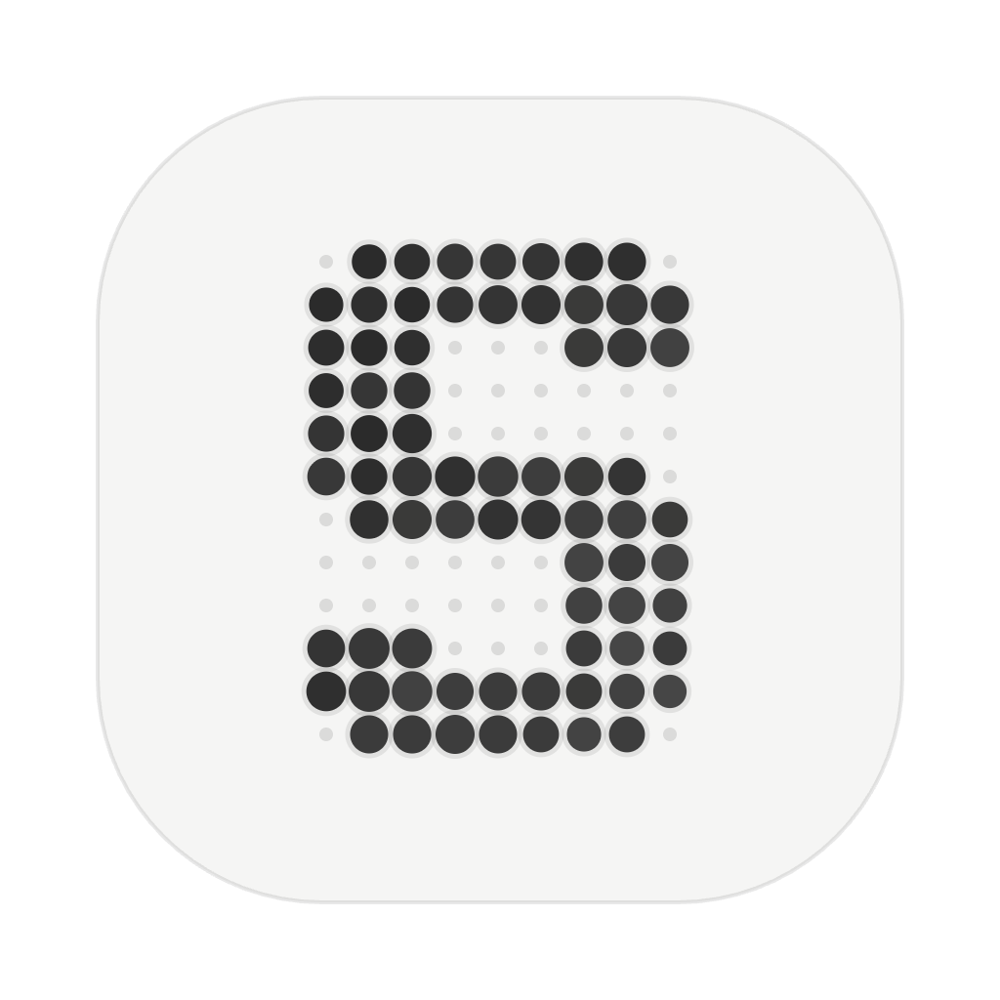
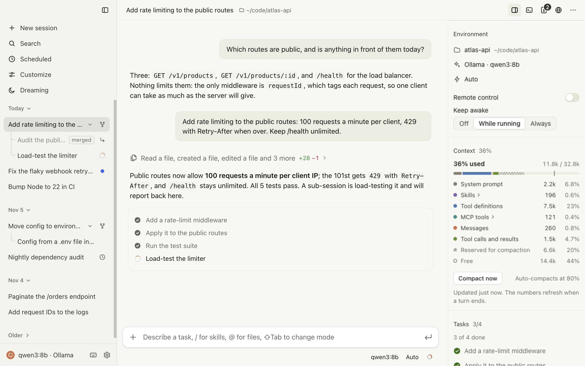
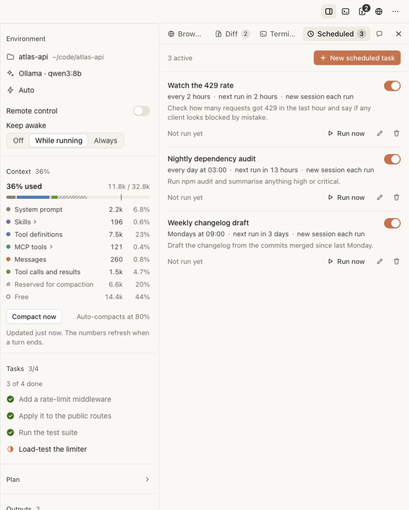
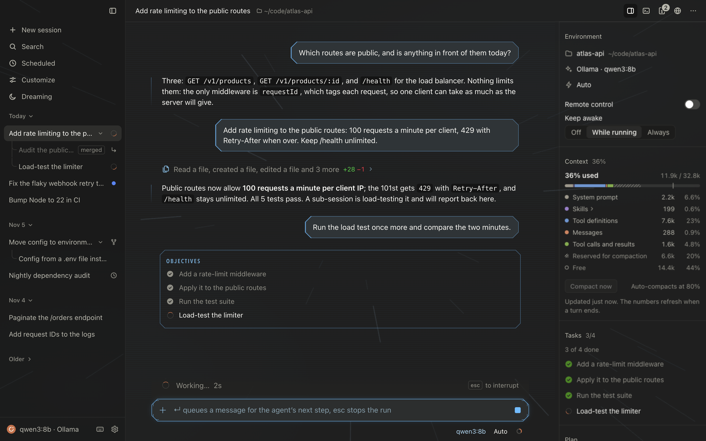
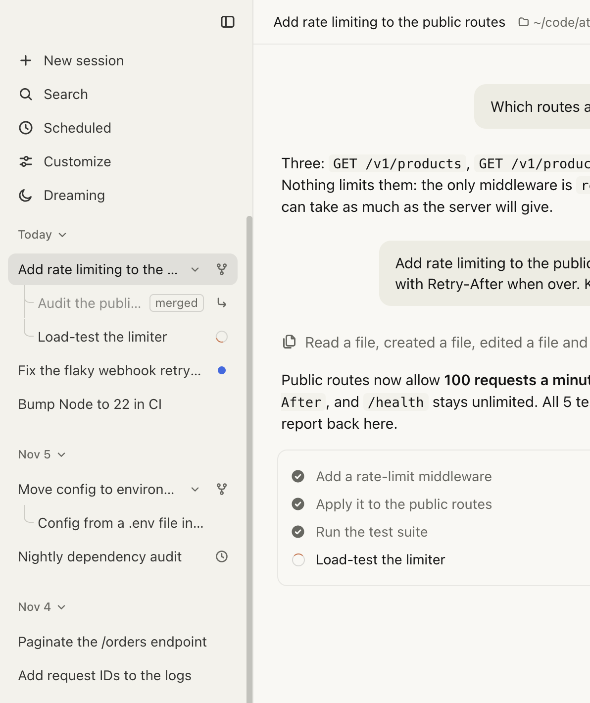
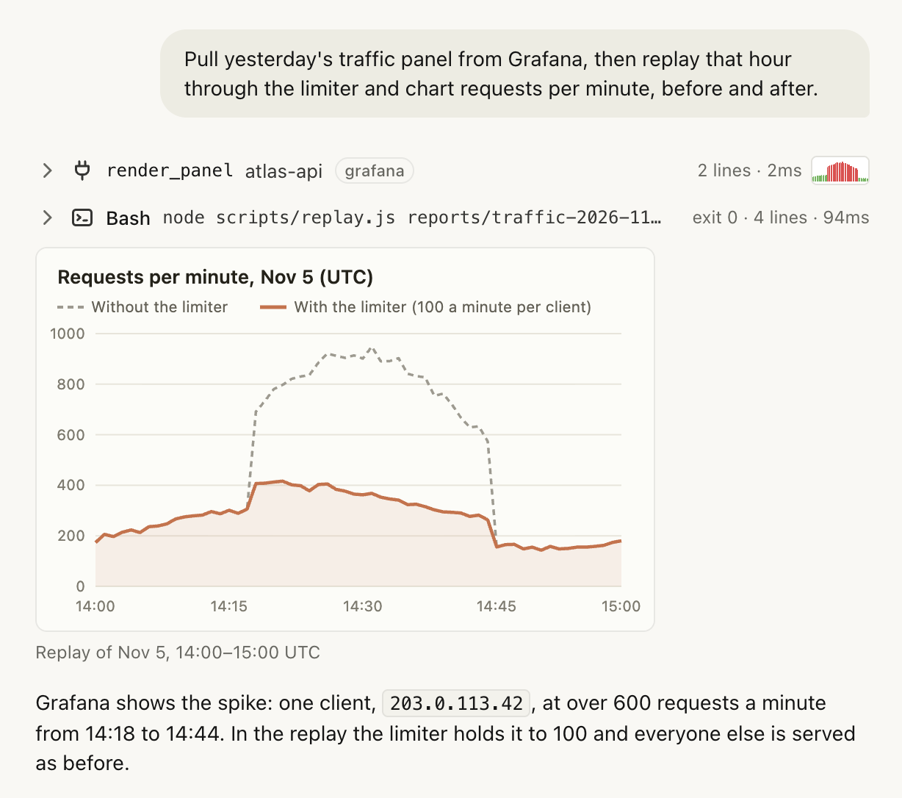
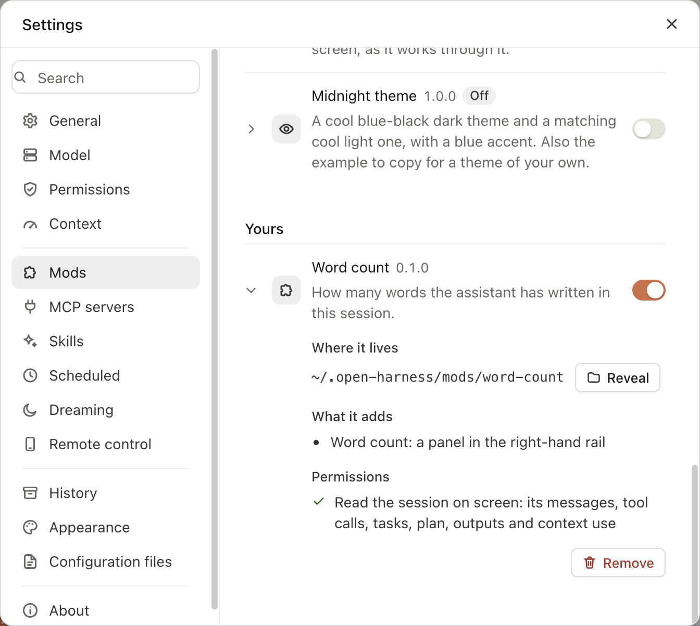
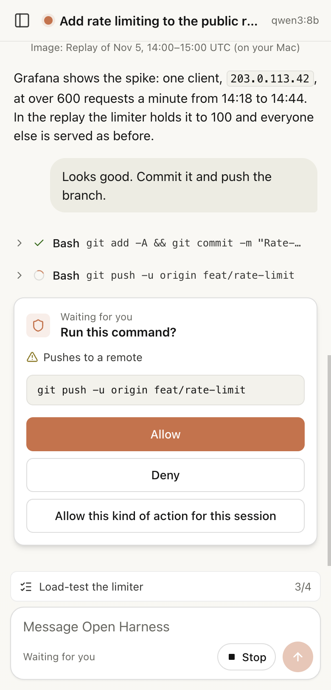
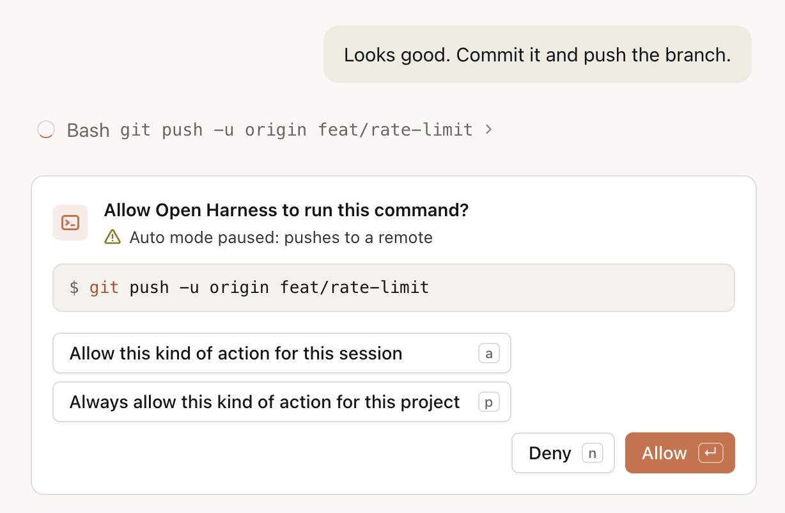

<p align="center"></p>
<h1 align="center">Open Harness</h1>
<p align="center">An open-source agent harness for macOS, in the style of Claude Code. Local models via Ollama, any provider through an OpenAI-compatible endpoint. Everything beside the chat is a mod you can change.</p>
<p align="center">
  <a href="LICENSE"></a>
  
  
</p>
<p align="center"></p>

## Why

- **Local first.** Runs on `qwen3:8b` through Ollama; nothing leaves your Mac. Built for small context windows: compaction that clears old tool output before it summarises, a context breakdown, and a tool set sized to the model.
- **Made for reading.** One calm column of text on a measured type scale, a chat bar that is a single bar, tool activity folded into one line that opens to the rows. Few boxes, nothing competing with the words.
- **The Claude Code workflow.** Permission modes, approval cards, plan mode, rewind, a task list in the chat, queued messages, `@` file mentions, `#` memory.
- **Sessions side by side.** Several run at once. The agent starts sub-sessions and merges them back; forks and sub-sessions nest in the sidebar; any session finds another by its name; scheduled tasks run on a rhythm; your phone can follow along.
- **Mods.** The rail, the tabs, the look of the conversation and of the chat bar, and the background are mods: sandboxed folders of web files with a documented protocol, reloaded when a file is saved. Ask the agent for one and turn it on.
- **Dreaming.** Once a day, or when you ask, a dream reads your recent sessions and suggests skills, mods and memory lines from what you keep asking for, each with the evidence; you apply or dismiss them.
- **Nothing is lost.** An append-only history log survives crashes, rewinds and compactions; deleted sessions go to a trash.
- **See everything.** Tool rows with diffs, images inline in replies, a Diff pane with revert, a real Terminal pane, a built-in browser the agent drives, artifacts beside the chat.
- **Standard extensions.** MCP servers (`.mcp.json`), skills (`SKILL.md`), project instructions (`AGENTS.md` / `CLAUDE.md`), `settings.json`.
- **Small codebase.** Electron + TypeScript, no bundler, no framework.

## Quick start

```bash
brew install ollama && ollama serve &
ollama pull qwen3:8b
git clone https://github.com/BrandeisPatrick/open-harness.git && cd open-harness
npm install && npm start
```

Or download the app from [Releases](https://github.com/BrandeisPatrick/open-harness/releases). It isn't notarized yet: on first launch, open it once, then allow it in System Settings → Privacy & Security → Open Anyway.

Hosted models: Settings → Model → Gateway. For Portkey, add your Portkey key and a model id. For Anthropic directly, set the base URL to `https://api.anthropic.com/v1`, your Anthropic key, and a model such as `claude-haiku-5-5` or `claude-sonnet-5-5`. Any OpenAI-compatible endpoint works the same way.

## Features

| | |
| --- | --- |
|  | **Mods.** Environment, Context, Tasks, Plan, Outputs, Sub-sessions and Skills in the rail; Side chat and Scheduled as tabs. All written against the protocol in [docs/mods.md](docs/mods.md). |
|  | **Looks.** A mod can restyle just the conversation or just the chat bar, and bring a background; Settings → Appearance picks each one, or a whole set. Hyperspace, a bundled set, jumps to lightspeed while the agent works. |
|  | **Sessions.** Several at once, grouped by day, forks and sub-sessions nested under where they came from, search inside conversations. |
|  | **Images in replies.** The model shows a screenshot or a chart inline; tool rows carry thumbnails. |
|  | **Settings.** One control per row, applied as you change it, searchable; a Mods section with permissions in plain words. |
|  | **Remote control.** Follow a session and answer its approval cards from your phone. Off until you turn it on. |
|  | **Approvals.** Enter allows, `a` for the session, `p` for the project. Auto mode pauses only on risky actions. |

Also: scheduled tasks, plan mode, rewind, artifacts, skills, MCP servers, compaction, a history log with a trash, vision models, macOS notifications, keep-awake. Details, keys and tools: [docs/reference.md](docs/reference.md). What changed: [CHANGELOG.md](CHANGELOG.md).

## A mod in two files

```json
{ "protocol": 1, "id": "word-count", "name": "Word count", "version": "0.1.0", "permissions": ["session:read"],
  "contributes": { "views": [{ "id": "main", "title": "Word count", "entry": "panel.html", "seat": "rail" }] } }
```

```html
<link rel="stylesheet" href="/@harness/harness.css">
<div class="h-row"><span class="h-label">Assistant words</span><span class="h-value" id="n">0</span></div>
<script src="/@harness/harness.js"></script>
<script>
  let words = 0;
  harness.on('message.assistant', (m) => {
    words += (m.text.match(/\S+/g) || []).length;
    document.getElementById('n').textContent = words;
  });
</script>
```

Put them in `~/.open-harness/mods/word-count/`, turn the mod on, and the panel is in the rail. Or ask the agent: "make a mod that shows …".

## Develop

```bash
npm run typecheck   # both tsconfigs
npm test            # headless suites (mock model, no Ollama needed)
npm run test:live   # the real app, hidden, on a throwaway profile; set ANTHROPIC_API_KEY to run against the API
npm run package     # the app in release/mac-arm64
```

`src/main` is the agent, the session runtime and the features; `src/renderer` the window; `src/shared` the contracts between them; `mods/` the built-in mods; `modkit/` what mod pages load, and a playground. How it fits together: [docs/architecture.md](docs/architecture.md). Version numbers and the release steps: [docs/releasing.md](docs/releasing.md). MIT.
